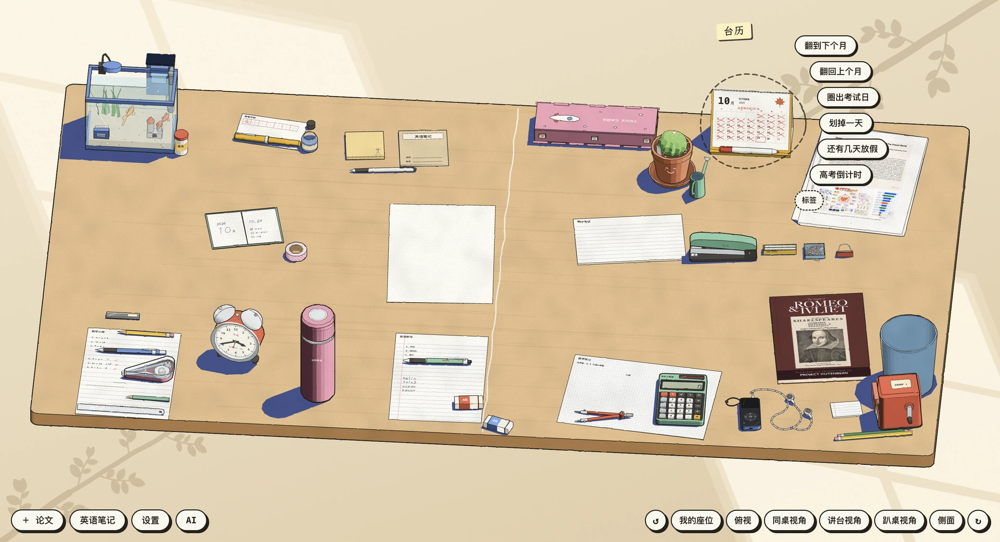
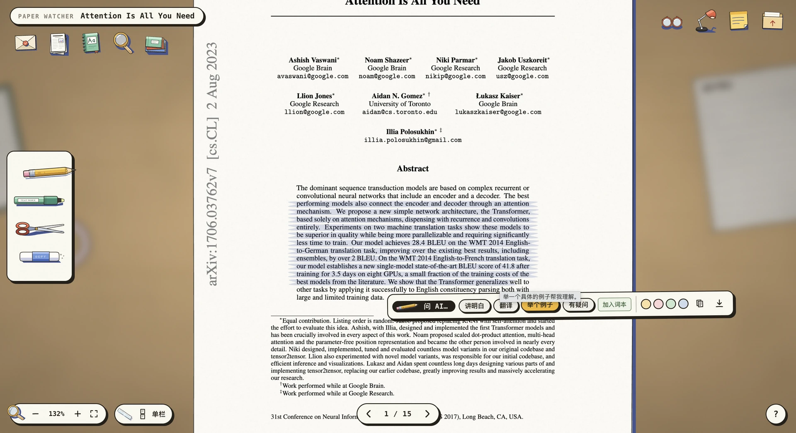
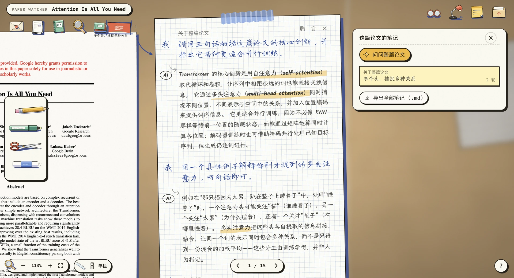
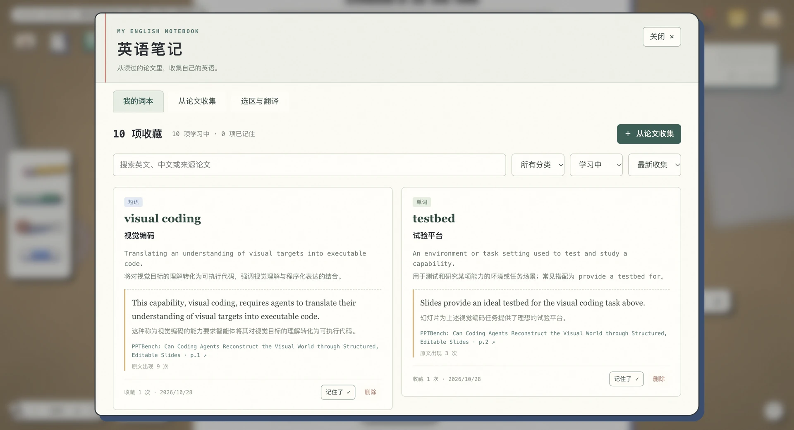
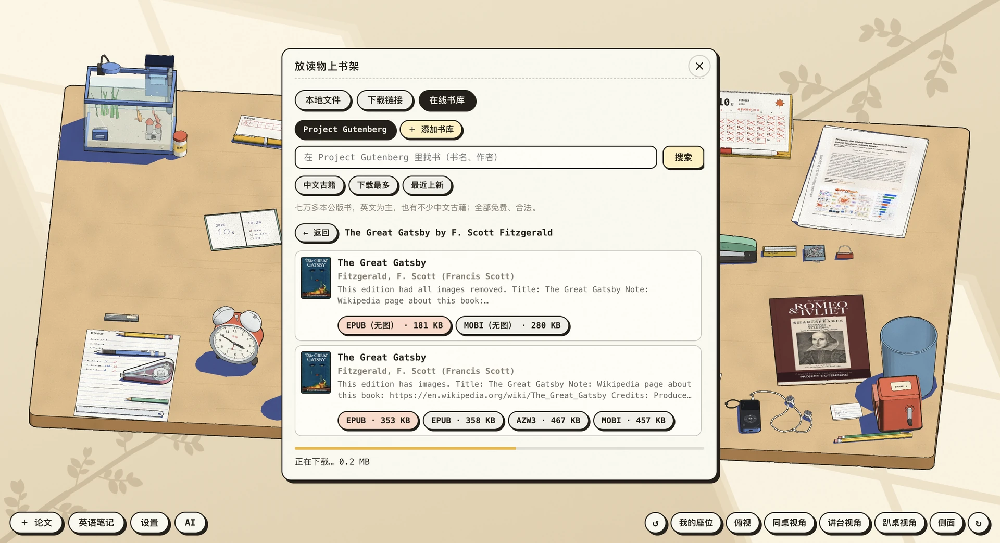

# Paper Watcher · 论文观察台

在浏览器里读论文，划重点、问 AI，顺手攒一本英语笔记。
界面是一张可以摆弄的书桌，论文和笔记都存在自己的电脑上。



## 开始使用

需要 **Node.js ≥ 22.13**。下载项目后，在项目目录运行：

```bash
npm install
npm start
```

启动后会打开 [http://127.0.0.1:5199](http://127.0.0.1:5199)。点「AI」选择一种连接方式：

| 方式 | 需要准备什么 |
|---|---|
| Claude Code | 安装并登录本地 `claude` |
| Codex | 安装本地 `codex`，运行 `codex login` 登录 |
| OpenAI 兼容 API | 填入接口地址、API Key 和模型名，支持 Chat Completions / Responses |

## 读论文，随手划重点

把 PDF 拖进窗口，或者粘贴 arXiv、OpenReview 等论文链接。
选中文字就能提问、翻译、举例或高亮；图表和公式也可以框选。



## 不懂的地方，接着问

AI 的回答会写在旁边的草稿纸上，可以继续追问，点击引用回到原文。
右上角的笔记本收着这篇论文的全部对话，读完也能导出成 Markdown。



## 读着读着，攒一本英语笔记

遇到想记的词、短语或句子，选中后点「加入词本」。也可以选一篇论文，告诉 AI 想学什么、要多少项，让它帮你整理。
每项都有中英释义和原文例句，点来源就能回到论文。词本可以按最近收集或收集次数排序，记住了就标记，不想留的可以删掉。



## 也可以换本书读

点桌上的书，可以导入 EPUB、MOBI、TXT、PDF 等文件，或从 Project Gutenberg 找一本。
目录、书签和搜索都有，读到哪里也会记住。



## 几个常用操作

| 操作 | 快捷键 |
|---|---|
| 翻页 | `←` / `→` |
| 搜索整篇论文 | `⌘F` / `Ctrl+F` |
| 适合阅读宽度 | `⌘0` / `Ctrl+0` |
| 换一篇论文 / 回到书桌 | `L` / `B` |
| 沉浸模式 / 查看快捷键 | `F` / `?` |

论文可以贴标签、搜索和批量整理；背景、灯光和桌面摆放也能自己调。
更多操作见 [使用指南](docs/guide.md)。

## 数据放在哪里

PDF、阅读位置、笔记和词本默认保存在 `data/`，备份整个文件夹即可。桌面配色、摆放等偏好保存在浏览器中。

使用 AI 时，相关问题、选区、图片或论文文本会发给你配置的服务。本地服务默认只监听 `127.0.0.1`。

想改端口、配置 AI 或排查问题，见 [使用指南](docs/guide.md)；想了解代码结构，见 [开发说明](docs/development.md)。
